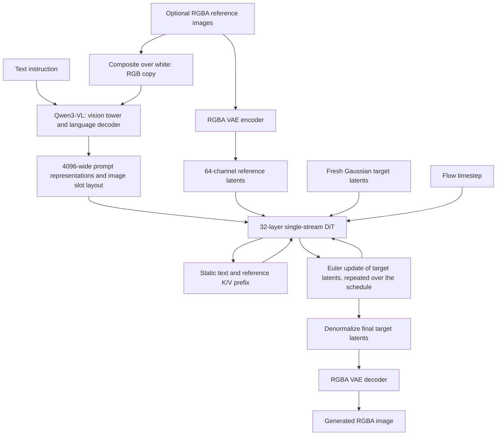

# Qwen-Image-2.1: architecture, capabilities, tensor shapes, and memory

Researched **2026-10-17**. This document describes the original open-weight
`Qwen/Qwen-Image-2.1` checkpoint used by this worker. Turbo and hosted API variants
are distinguished below. Numbers describe the identified revisions, not an
unversioned model family.

## 1. Evidence, versions, and scope

The numerical specification is based on official checkpoint JSON configurations,
the actual safetensors tensor headers, and the inference implementation. Weight
headers were read using bounded HTTP Range requests; the model weights were not
downloaded, and GPU inference was not performed.

| Item | Version inspected |
|---|---|
| Worker model | `Qwen/Qwen-Image-2.1` |
| Worker repository commit | `54ce8e2bedbc239faf4944757112ce81659e2e66` |
| Worker checkpoint revision | `790c92633540aa0cb11d9abf19eb46d861714758` |
| Worker Diffusers source | `e0118ade2f60234c41bacf40330a7e2f61108849` |
| Worker Transformers | `5.17.0` |
| Official Qwen repository observed | `ab96caa944157ca28a4f36b695c3047549f48f98` |
| Hugging Face `main` observed | `d26bb61231c349cf6b7896fa83353113880e1ba3` |

Evidence labels used throughout:

- **Config:** a value in an official configuration file.
- **Header:** a stored tensor shape, precision, or count read from a weight header.
- **Implementation:** behavior visible in the pinned inference code.
- **Derived:** arithmetic from those values, with assumptions stated.
- **Claim/example:** a capability presented by Qwen; not independently benchmarked here.
- **Unknown:** information not established by the inspected sources.

The companion [complete machine-readable specification](docs/qwen-image-2.1-spec.json)
contains the configs, their hashes and source URLs, shard sizes, and **every one
of the 1,285 stored tensors**, including its name, shape, dtype, element count,
byte count, and source shard. This is the exhaustive dimension inventory; the
tables below explain how those tensors are used.

Primary sources are listed in [section 17](#17-primary-sources).

## 2. Overall design and parameter counts

Qwen-Image-2.1 is a latent flow-matching image model. A Qwen3-VL multimodal encoder
conditions a single-stream diffusion transformer, and an RGBA VAE converts between
pixels and 64-channel latents. It generates an image by repeatedly updating the
whole target latent grid, rather than emitting image pixels autoregressively.
[S1, S2, S3, S4, S5, S7, S8]



The main transformer stacks contain **32 DiT blocks, 36 language decoder blocks,
and 27 vision blocks**: 95 blocks across three separate components. The VAE
additionally has its own two single-head attention modules and 29 convolutional
residual blocks; those are counted separately below.

### Stored parameters versus advertised size

**Header counts:** sum `product(shape)` over stored tensors; no tied-embedding
deduplication is needed because the embedding and LM head are separate weights.
These are checkpoint tensor counts, not measured allocations of a running model.

| Component | Stored elements | Tensor count | Stored precision | Parameter memory if entirely BF16 |
|---|---:|---:|---|---:|
| Image DiT | 7,115,124,736 | 297 | BF16 | 13.253 GiB |
| Full Qwen3-VL conditioner | 8,767,123,696 | 750 | BF16 | 16.330 GiB |
| RGBA VAE | 337,740,404 | 238 | FP32 in the checkpoint | 0.629 GiB |
| **Entire pipeline** | **16,219,988,836** | **1,285** | Mixed on disk | **30.212 GiB** |

The public **7B** description refers to the image generation transformer. The
full supplied pipeline contains approximately **16.22B** stored parameters.
The worker requests `torch.bfloat16` at load time; the VAE's on-disk FP32 storage
therefore does not mean the worker intentionally runs that whole component in FP32.
Runtime buffers, casting exceptions, temporary tensors, allocator reservations,
and framework/kernel memory are additional. [S1, S8, S11]

| Weight files | File bytes, including safetensors headers |
|---|---:|
| DiT, two shards | 14,230,284,408 |
| Conditioner, four shards | 17,534,339,488 |
| VAE, one file | 1,350,989,512 |
| **All seven weight files** | **33,115,613,408 bytes**, approximately **33.12 decimal GB** |

Tokenizer files and other metadata add to this disk footprint. The Hugging Face
model-level parameter summary reports the DiT-sized count at this revision;
it should not be used as the total for all subdirectories. [S11]

## 3. Image diffusion transformer: exact specification

**Config and headers.** [S2, S7, S11]

| Property | Value |
|---|---|
| Class | `QwenImage21Transformer2DModel` |
| Architecture | One shared text/image stream; 32 transformer blocks |
| Hidden width `D` | 4,096 |
| Attention heads | 32 query heads, **32 K/V heads**: ordinary MHA |
| Head width | 128; `32 × 128 = 4096` |
| Feed-forward intermediate width | 12,288; `mlp_ratio = 3` |
| Feed-forward activation | SwiGLU: `down(SiLU(gate(x)) * up(x))` |
| Input/output latent channels | 64 / 64 |
| Latent patch size | 1; no 2×2 latent packing into the channels |
| Context input width | 4,096 |
| Attention projection biases | None |
| Feed-forward projection biases | None |
| Attention dropout | 0 |
| Attention dot-product scaling | `1/sqrt(128)`, approximately 0.08838835 |
| Pre-attention/pre-MLP normalization | LayerNorm, no learned affine parameters |
| Q/K normalization | Learned per-head RMSNorm, epsilon `1e-6` |
| Text input normalization | Zero-centered learned RMSNorm, epsilon `1e-6` |
| Output normalization | Timestep-conditioned affine-free LayerNorm with scale modulation |
| Positional encoding | Three-axis RoPE, real dimensions `[16, 56, 56]` |
| RoPE base | 10,000 |
| Prefix timestep policy | `causal_condition = true`: text and reference tokens use timestep zero |

### One block, repeated 32 times

Here `s1, g1, s2, g2` are the timestep-derived scale/gate vectors selected for
each token. All blocks receive the **same shared modulation vectors**; there is
no separate learned timestep projection in each block.

```text
a = LayerNorm(x) * (1 + s1)
x = x + tanh(g1) * Attention(a)
m = LayerNorm(x) * (1 + s2)
x = x + tanh(g2) * SwiGLU(m)
```

The learned projections in each block have these PyTorch weight shapes
(`[output_features, input_features]`):

| Weight, relative to `transformer_blocks.i` | Shape | Elements |
|---|---|---:|
| `attn.to_q.weight` | `[4096, 4096]` | 16,777,216 |
| `attn.to_k.weight` | `[4096, 4096]` | 16,777,216 |
| `attn.to_v.weight` | `[4096, 4096]` | 16,777,216 |
| `attn.to_out.0.weight` | `[4096, 4096]` | 16,777,216 |
| `attn.norm_q.weight` | `[128]` | 128 |
| `attn.norm_k.weight` | `[128]` | 128 |
| `img_mlp.gate_layer.weight` | `[12288, 4096]` | 50,331,648 |
| `img_mlp.proj.weight` | `[12288, 4096]` | 50,331,648 |
| `img_mlp.out.weight` | `[4096, 12288]` | 50,331,648 |
| **One block** | Nine stored tensors | **218,104,064** |

All 32 blocks together contain **6,979,330,048** parameters. The remaining
**135,794,688** parameters are in the input, time, modulation, and output modules:

| Outside-block weight | Shape |
|---|---|
| `img_in.weight` | `[4096, 64]` |
| `txt_in.text_norm.weight` | `[4096]` |
| `txt_in.in_layer.weight` | `[4096, 4096]` |
| `txt_in.out_layer.weight` | `[4096, 4096]` |
| `time_text_embed.timestep_embedder.linear_1.weight` | `[4096, 256]` |
| `time_text_embed.timestep_embedder.linear_2.weight` | `[4096, 4096]` |
| `modulation.1.weight` | `[16384, 4096]` |
| `norm_out.linear.weight` | `[4096, 4096]` |
| `proj_out.weight` | `[64, 4096]` |

The text projection applies normalization, a linear layer, SiLU, then another
linear layer. The timestep path starts with 256 sinusoidal features and projects
to 4096. The shared modulation projects 4096 to `4 × 4096`. Prefix tokens select
the zero-timestep modulation; target tokens select the current denoising timestep.
The final projection produces a 64-channel flow prediction. [S7]

### Position layout

RoPE splits each 128-wide head into frame/order, height, and width dimensions
`16 + 56 + 56`. Text advances its position on all three axes. Each image has a
fixed frame/order position and a spatial grid centered around zero; the sequence
position advances between image blocks. K is normalized and rotated before
being cached; V is the projected value tensor and does not receive RoPE. [S7]

The pinned implementation precomputes 8,192 nonnegative positions and 1,024
negative positions for these lookup tables. This is an implementation detail,
**not a verified 262,144-token DiT context**. Long prompts and extreme layouts
must be checked against this implementation rather than extrapolated from the
conditioner's larger context configuration.

## 4. Qwen3-VL conditioner: language and vision stacks

The component named `text_encoder` is a complete
`Qwen3VLForConditionalGeneration`, including a vision tower and an untied language
output head. Image generation uses its hidden representations; it does not ask
this model to autoregressively write the output image. [S3, S8, S9]

### Language stack

| Property | Value |
|---|---|
| Decoder blocks | **36** |
| Hidden width | 4,096 |
| SwiGLU intermediate width | 12,288 |
| Query heads | 32 |
| K/V heads | **8**; grouped-query attention, four query heads per K/V head |
| Head dimension | 128 |
| Q/O weight shapes | `[4096, 4096]` |
| K/V weight shapes | `[1024, 4096]` |
| Gate/up weights | `[12288, 4096]` |
| Down weight | `[4096, 12288]` |
| Normalization | RMSNorm; pre-attention, pre-MLP, final, and Q/K norms |
| RMS epsilon | `1e-6` |
| Attention bias/dropout | false / 0 |
| Vocabulary | 151,936 entries |
| Token embeddings | `[151936, 4096]`, 622,329,856 elements |
| Untied LM head | `[151936, 4096]`, another 622,329,856 elements |
| Configured maximum positions | 262,144 |
| Text RoPE base | 5,000,000 |
| Multimodal RoPE configuration | Interleaved, sections `[24, 20, 20]` |
| Default config `use_cache` | true; overridden to false by this worker |

Stored parameter groups are **7,568,405,504** in `model.language_model`,
**622,329,856** in `lm_head`, and **576,388,336** in `model.visual`.
The language-model group already includes its input embeddings. Together these
sum to **8,767,123,696**. [S3, S9, S11]

The conditioner and DiT both have 4096-wide representations, but their attention
is different: **8 K/V heads in the language model versus 32 in the DiT**.
Using the language model's GQA dimensions for the DiT cache would underestimate
that cache by a factor of four. Each of the 36 language decoder blocks has
**192,946,432** stored parameters, including its norm weights.

### Vision tower and feature mergers

| Property | Value |
|---|---|
| Vision transformer blocks | **27** |
| Hidden width | 1,152 |
| Attention heads / head width | 16 / 72 |
| MLP width / activation | 4,304 / GELU with tanh approximation |
| Input channels | 3: RGB copy of references |
| Spatial patch | 16×16 pixels |
| Temporal patch | 2; a still image is handled by the image processor, not video generation |
| Patch embedding weight | `[1152, 3, 2, 16, 16]` |
| QKV weight / output weight | `[3456, 1152]` / `[1152, 1152]` |
| MLP weights | `[4304, 1152]` and `[1152, 4304]` |
| Learned position table | `[2304, 1152]`, with interpolation in the implementation |
| Spatial merge | 2×2 patches per merged image slot |
| Merged feature width before MLP | `4 × 1152 = 4608` |
| Merger MLP weights | `[4608, 4608]`, then `[4096, 4608]` |
| Merger output width | 4,096 |
| DeepStack feature taps | Vision block indices **8, 16, 24**, zero-based |

There is one final merger and three DeepStack mergers. The intermediate visual
features are injected into the first three language decoder layers. The final
vision features replace the image placeholders in the language input. [S3, S9]

The processor uses RGB conversion, pixel rescaling by `1/255`, and mean/std
`[0.5, 0.5, 0.5]`. Its generic area bounds are 65,536 to 16,777,216 pixels,
with patch size 16 and merge size 2. Those bounds describe the processor config;
the image pipeline separately resizes references according to `output_resolution`.
[S10]

### Which hidden states condition the DiT?

The pinned pipeline takes the **last decoder block's output before the final
language RMSNorm**, drops the leading system-message tokens, and keeps the
remaining non-padding sequence plus its image-slot mask. A temporary hook handles
the change in hidden-state behavior between Transformers versions. Simply using
the normalized last hidden state can change generation quality. [S8]

Reference-image slots subsequently receive actual VAE latent features in the
DiT stream. The VLM image slots define the layout; their 4096-wide features are
not concatenated a second time alongside the replacement VAE tokens.

The worker also requests `logits_to_keep=1`, because full-sequence language
logits are unused, and `use_cache=False`, because there is no autoregressive
language decoding in this conditioning pass. It still requests hidden states,
which can retain outputs from many language layers during conditioning. [S12]

## 5. RGBA VAE: dimensions, blocks, and normalization

**Config, implementation, and headers.** [S4, S13, S11]

| Property | Value |
|---|---|
| Class | `AutoencoderKLQwenImage21` |
| Parameters | 337,740,404 |
| Pixel input/output channels | **4 / 4**, RGBA |
| Latent channels | **64** |
| Spatial compression | **16 per side**, or 256 pixels per latent grid position |
| Encoder base width | 96 |
| Decoder base width | 144 |
| Width multipliers | `[1, 2, 4, 8, 8]` |
| Encoder residual blocks per stage | 2 |
| Decoder residual blocks per stage | 3: the implementation uses `num_res_blocks + 1` |
| Encoder / decoder stages | 5 / 5 |
| Encoder / decoder spatial resampling transitions | 4 / 4 |
| Middle block, each side | Residual block → single-head attention → residual block |
| Total residual blocks | **12 encoder + 17 decoder = 29** |
| Attention blocks | **2** total: one encoder middle block and one decoder middle block |
| Stored convolution weight tensors | 38 encoder + 48 decoder + 2 quantization projections = **88** |
| Residual block operation | RMS normalization, SiLU, 3×3 convolution, RMS normalization, SiLU/dropout, 3×3 convolution, residual addition |
| Extra shortcut convolution | 1×1 when a residual block changes channel width |
| Dropout | 0 |
| Residual resampling | `is_residual=true`; average-down/duplication-up shortcut paths around resampling stages |
| Stage attention scales | `[]`; the two middle attention blocks still exist |

The convolution count includes attention's 1×1 QKV/output convolutions, stored
temporal-path tensors, and the outer quantization projections. It counts stored
weights, not the number of convolution calls executed for a single still image. A raw convolution count and a residual-block
count refer to different units; neither should be called the model's single
unqualified “layer count.”

### Encoder spatial progression

`H` and `W` below are the reference image dimensions after preprocessing.

| Stage | Main channel transition | Residual blocks | Spatial size after stage |
|---|---|---:|---|
| Input 3×3 convolution | 4 → 96 | — | `H × W` |
| Down stage 0 | 96 → 96 | 2 | `H/2 × W/2` |
| Down stage 1 | 96 → 192 | 2 | `H/4 × W/4` |
| Down stage 2 | 192 → 384 | 2 | `H/8 × W/8` |
| Down stage 3 | 384 → 768 | 2 | `H/16 × W/16` |
| Stage 4, no downsample | 768 → 768 | 2 | `H/16 × W/16` |
| Middle | 768 | 2 plus attention | `H/16 × W/16` |
| Norm and output convolution | 768 → 128 | — | `H/16 × W/16` |
| `quant_conv`, 1×1 | 128 → 128 | — | `H/16 × W/16` |

The 128 channels parameterize the diagonal posterior's 64 means and 64 log
variances. The pinned pipeline encodes references using the posterior **mode**,
not random posterior samples. This makes reference latent reuse deterministic.

### Decoder spatial progression

| Stage | Main channel transition | Residual blocks | Spatial size after stage |
|---|---|---:|---|
| `post_quant_conv`, 1×1 | 64 → 64 | — | `H/16 × W/16` |
| Input 3×3 convolution | 64 → 1152 | — | `H/16 × W/16` |
| Middle | 1152 | 2 plus attention | `H/16 × W/16` |
| Up stage 0 | 1152 → 1152 | 3 | `H/8 × W/8` |
| Up stage 1 | 1152 → 1152 | 3 | `H/4 × W/4` |
| Up stage 2 | 1152 → 576 | 3 | `H/2 × W/2` |
| Up stage 3 | 576 → 288 | 3 | `H × W` |
| Stage 4, no upsample | 288 → 144 | 3 | `H × W` |
| Norm and output 3×3 convolution | 144 → 4 | — | `H × W` |

For still images the API tensor convention is `[B, C, 1, H, W]`. Despite
inherited names such as `CausalConv3d`, the pinned specialization stores 2D
convolution weights and removes/restores the singleton frame axis around each
convolution. The config retains temporal compression `8` and temporal downsample
flags `[false, true, true, true]`; these do **not** establish a supported video
generation mode. [S4, S13]

### Latent normalization

Each of the 64 channels has its own trained mean and standard deviation:

```text
DiT reference latent = (VAE posterior mode - mean[channel]) / std[channel]
VAE decode input     = final DiT latent * std[channel] + mean[channel]
```

All 64 means and all 64 standard deviations are preserved exactly in the JSON
companion and in the configuration appendix below. They are not a single
Stable-Diffusion-style scalar scale factor.

The VAE sees the original four channels. Only the copy sent through the VLM's
vision tower is alpha-composited onto white. Removing alpha before VAE encoding
would change the editing condition. [S8]

## 6. Image tokenization, mixed granularity, and sequence shapes

Two distinct granularities matter: image patches in the conditioner, and image
latent tokens in the DiT. Separately, Qwen describes the **attention mask** as
mixed-granularity because text is causal per token while image blocks are
bidirectional internally. [S7, S8, S9, S14]

For an image with dimensions divisible by 32:

```text
VAE grid / DiT image tokens: N = (H / 16) * (W / 16)
Raw VLM spatial patches:        (H / 16) * (W / 16)
Merged VLM image slots:     V = (H / 32) * (W / 32) = N / 4
```

The DiT expands each VLM image slot to **four** positions and substitutes the
corresponding VAE latent tokens. This is an expansion in sequence length, not
four latent vectors concatenated into 256 input channels. The actual DiT latent
input width remains **64**, and its patch size remains **1**.

Let `T` be the retained non-image prefix positions, including template/special
tokens and any physical padding. With reference token counts `N1...Nr`:

```text
VLM retained sequence length: S = T + sum(Ni / 4)
DiT static prefix length:    P = T + sum(Ni)
Target latent tokens:        N = Hout * Wout / 256
DiT prefill sequence:        P + N
Cached-step query sequence:  N
Cached-step key sequence:    P + N
```

Padding and system-prefix removal make `T` different from the raw prompt's token
count. In a padded batch, memory follows allocated lengths, not just valid tokens.

| Square image | Latent grid | DiT tokens `N` | Merged VLM slots `N/4` | Raw 64-channel latent, BF16 |
|---|---|---:|---:|---:|
| 512×512 | 32×32 | 1,024 | 256 | 128 KiB |
| 1024×1024 | 64×64 | 4,096 | 1,024 | 512 KiB |
| 2048×2048 | 128×128 | 16,384 | 4,096 | 2 MiB |

Example: a 1024-square output plus one 1024-square reference and `T=512` has
`S=1536`, `P=4608`, and `N=4096`:

| Tensor | Shape for batch one |
|---|---|
| VLM retained prompt representations | `[1, 1536, 4096]` |
| Reference VAE latent | `[1, 64, 1, 64, 64]` |
| Packed reference latent | `[1, 4096, 64]` |
| Packed target latent | `[1, 4096, 64]` |
| DiT joint input after projection/slot replacement | `[1, 8704, 4096]` |
| Prefill Q, K, or V per layer | `[1, 8704, 32, 128]` |
| Stored prefix K or V per layer | `[1, 4608, 32, 128]` |
| Later-step Q per layer | `[1, 4096, 32, 128]` |
| Later-step concatenated K or V | `[1, 8704, 32, 128]` |
| Target flow prediction used by Euler | `[1, 4096, 64]` |

These are derived shapes, assuming the resized reference dimensions and retained
text length above. The full tensor inventory records parameter shapes, while
these tables describe runtime activations.

## 7. Attention visibility and why caching is valid

For query position `q` and key position `k`, the visibility rule is:

```text
visible(q, k) = (q >= k) OR (q and k belong to the same image block)
```

Invalid padded keys are additionally excluded. Each reference and the target
have their own image-block ID; neighboring images remain distinct even if no
ordinary text token separates them. [S7]

Consequences:

- Text attends to earlier positions and itself, not future tokens.
- A reference attends to the preceding sequence and all positions of itself.
- An earlier reference cannot see a later reference.
- The target is last: it sees the entire prefix and all of its own image tokens.
- Text after the references can incorporate those earlier references.
- Prefix states cannot depend on the changing target because the target is later.

The prefix also receives **timestep-zero modulation** instead of current-step
modulation. Together, the attention direction and fixed modulation make prefix
states invariant across denoising steps. Prefix K/V can therefore be computed
once per layer and reused exactly in the model's real-valued computation.

This is not autoregressive image generation. A cached step still recomputes
**every target query, key, and value** through all 32 layers and updates the full
target grid. It does not append a newly generated pixel/token to an ever-growing
target cache. Floating-point kernels and changed operation shapes can make
cache-on and cache-off BF16 results differ numerically despite the same
mathematical dependency structure.

## 8. Prefix KV cache: exact storage formula

Each of the 32 DiT layers retains two tensors:

```text
K: [B, P, 32, 128]
V: [B, P, 32, 128]
```

For element size `b` bytes, the logical persistent storage for one branch is:

```text
cache_bytes = B * P * layers * 2 * KV_heads * head_dim * b
            = B * P * 32 * 2 * 32 * 128 * b
```

For BF16 (`b=2`):

```text
per layer, per prefix token:  16,384 bytes = 16 KiB
all 32 layers, per token:    524,288 bytes = 512 KiB = 0.5 MiB
one branch:                 B * P / 2048 GiB
multiple CFG branches:      B * (Ppositive + Pnegative) / 2048 GiB
```

This is a derived **logical K/V tensor storage** figure. It excludes tensor
metadata, allocator overhead, parameters, projected embeddings, transient
concatenations, attention workspaces, and other activations. [S7]

### Cost of each reference image alone

The table excludes text. Dimensions refer to the image **after** resizing.

| Reference dimensions | Prefix tokens added | BF16 cache added, one output and one branch |
|---|---:|---:|
| 512×512 | 1,024 | **0.5 GiB** |
| 1024×1024 | 4,096 | **2 GiB** |
| 2048×2048 | 16,384 | **8 GiB** |
| 2400×1792 | 16,800 | 8.203125 GiB |
| 2528×1696 | 16,748 | 8.177734375 GiB |
| 2752×1536 | 16,512 | 8.0625 GiB |

Every **512 retained text positions add 0.25 GiB**. For one output and a
512-position text/template prefix:

| References | Resolution of each resized reference | Total prefix tokens | BF16 cache, one branch |
|---|---|---:|---:|
| 0 | — | 512 | 0.25 GiB |
| 1 | 512×512 | 1,536 | 0.75 GiB |
| 1 | 1024×1024 | 4,608 | 2.25 GiB |
| 4 | 1024×1024 | 16,896 | 8.25 GiB |
| 10 | 1024×1024 | 41,472 | 20.25 GiB |
| 1 | 2048×2048 | 16,896 | 8.25 GiB |
| 4 | 2048×2048 | 66,048 | 32.25 GiB |
| 10 | 2048×2048 | 164,352 | **80.25 GiB** |

These figures explain why “supports ten references” does not mean “ten 2K
references fit on one 80 GB GPU.” The logical cache alone can exceed that GPU,
before any parameters or activations.

### CFG, output batches, precision, and steps

- **True CFG:** separate positive and negative caches are created. If both
  prefixes have the same length, their persistent cache storage doubles. The
  reference latents appear in both branches. The two transformer calls execute
  sequentially in this pipeline, but both branch caches remain live.
- **Parallel outputs:** the pinned implementation physically stores K/V for each
  expanded output in batch `B`; it does not broadcast one shared cache across
  identical outputs. Four outputs multiply persistent K/V storage by four.
- **Sequential outputs:** the worker reuses conditioning within the job, but each
  pipeline call creates a fresh DiT cache. Sequential outputs do not keep every
  previous output's DiT cache alive.
- **Denoising steps:** persistent cache storage does **not** multiply by the step
  count. The prefix is reused; the target is not appended to it.
- **Precision:** FP32 K/V doubles the BF16 numbers. An actual 8-bit K/V
  implementation would roughly halve payload storage before scales and metadata,
  but no such cache format is implemented by this pinned worker.
- **Quantized weights:** reducing parameter precision does not automatically
  reduce activation or K/V precision. Cache dtype follows its actual tensors.

### Allocation and lifetime details

On the first step, mode `extract` processes the full stream and saves the prefix
K/V. The implementation uses **clones**, avoiding views that retain a larger
full-sequence backing allocation. Later steps use mode `cached`, slice the joint
stream to target queries, and concatenate saved prefix K/V with fresh target K/V
for attention. [S7, S8]

Consequently, a cached step still has transient memory beyond the persistent
cache: current-layer Q/K/V and concatenated K/V are examples. The implementation
also constructs input projections and sequence metadata before its target-only
block slicing, so caching does not eliminate all prefix-related work.

The caches are local to one pipeline invocation and remain referenced while the
VAE decodes the output. They are not a global cross-request prefix cache in this
worker. Model CPU offloading moves modules; it does **not** automatically move
these ordinary request-local K/V tensors to CPU.

Setting `use_kv_cache=false` removes persistent DiT prefix storage but recomputes
the full stream in every block at every denoising step. It can reduce memory
pressure while increasing compute; the actual peak depends on the attention
backend and other live tensors.

## 9. Other caches and memory: keep them separate

| Object | Contents | Lifetime / worker behavior |
|---|---|---|
| DiT prefix K/V | 32 layers of text/reference keys and values | One pipeline call; enabled by `use_kv_cache` |
| Qwen3-VL autoregressive cache | Language decoder K/V with eight K/V heads | Disabled by the worker's conditioning hook |
| Prompt conditioning reuse | Encoded prompt representations and layout masks | Reused only inside one immutable worker job |
| Reference latent reuse | Deterministic normalized VAE latents | Reused inside that same job |
| VAE feature-cache machinery | Internal convolution/tiling bookkeeping | Different from attention K/V; cleared by VAE lifecycle methods |
| Hugging Face disk cache | Checkpoint files | Persistent storage if a persistent volume is configured |
| CUDA allocator cache | Reusable allocations reserved by PyTorch | Neither a model prefix cache nor a live-tensor eviction mechanism |

**Hypothetical conditioner K/V:** if language caching were enabled, BF16 payload
for an encoded sequence of `Senc` positions would be:

```text
B * Senc * 36 layers * 2 * 8 KV heads * 128 * 2 bytes
= B * Senc * 147456 bytes
= 144 KiB per encoded position per batch item
```

`Senc` includes the conditioning system prompt and merged vision slots; it is
not the expanded DiT prefix `P`. At 4,096 encoded positions, this would be
576 MiB. This is not an allocation retained by the current worker, because it
explicitly uses `use_cache=False`. [S3, S9, S12]

Prompt representations themselves occupy `B × S × 4096 × b` bytes. Retaining
hidden states from many conditioner layers can multiply that footprint during
encoding. A full-sequence LM logits tensor would instead scale with the 151,936
vocabulary; keeping only the last logits position avoids that unnecessary large
output. It does not unload the LM-head weights or remove all intermediate states.

Raw latents are small compared with their expanded DiT features and per-layer
cache. At 2K, a single BF16 `[1,16384,4096]` feature tensor is **128 MiB**, whereas
the raw `[1,16384,64]` latent is only **2 MiB**.

### Attention score memory and compute scaling

For cached target queries, a conventional explicitly materialized score tensor
would contain `B × 32 × N × (P+N)` elements **per layer**. With a 2K target,
`N=16384`, and `P=512`, that is **16.5 GiB at BF16**, or **33 GiB at FP32**.
This is an illustrative dense-score calculation, not a claim that the normal
optimized attention backend allocates that matrix.

Memory-efficient SDPA/Flash/Flex kernels avoid storing the complete dense score
matrix. The pinned source defaults to segmented SDPA prefill. Its optional Flex
processor expects compilation for efficient prefill; the source explicitly warns
that an uncompiled Flex fallback can materialize dense FP32 attention scores.
Backend and compilation choices materially affect real peak VRAM. [S7]

Ignoring embeddings, norms, and shared modulation, one block's main linear
projections require `4D² + 3DM = 218,103,808` multiply-accumulates per processed
token, where `D=4096` and `M=12288`. Cached steps reduce the block projection/MLP
token count from `P+N` to `N`, but target attention still attends to the prefix.
Attention's two matrix products cost approximately `2 × B × N × (P+N) × D`
multiply-accumulates per cached block. These are arithmetic operation estimates,
not measured latency or GPU throughput.

Doubling both target dimensions gives four times as many tokens and roughly
sixteen times the target-self-attention arithmetic when that term dominates.
Doubling both reference dimensions gives four times the reference cache and
roughly four times its contribution to target-to-prefix attention work.

## 10. Resolution and reference preprocessing

Native recommended generation is approximately **2K per side**, roughly
**4.2 megapixels** for the standard presets. “2K” does not mean two million
pixels here. Qwen lists these sizes. [S1]

| Aspect | Width × height | Target latent grid, width × height | Target tokens |
|---|---|---|---:|
| 1:1 | 2048×2048 | 128×128 | 16,384 |
| 4:3 | 2400×1792 | 150×112 | 16,800 |
| 3:4 | 1792×2400 | 112×150 | 16,800 |
| 3:2 | 2528×1696 | 158×106 | 16,748 |
| 2:3 | 1696×2528 | 106×158 | 16,748 |
| 16:9 | 2752×1536 | 172×96 | 16,512 |
| 9:16 | 1536×2752 | 96×172 | 16,512 |

**Pinned implementation:** explicit target width and height must be divisible
by **32**, although latent compression alone is 16. This keeps the merged
vision-slot/latent layout compatible. [S8]

Reference preprocessing preserves aspect ratio, aims for area
`output_resolution²`, and rounds each dimension to a multiple of 32:

```text
r = original_width / original_height
w_float = sqrt(output_resolution² * r)
h_float = w_float / r
w = round(w_float / 32) * 32
h = round(h_float / 32) * 32
```

Thus references need not be square, and their rounded area need not equal the
requested area exactly. Cache memory follows the resulting `w*h/256` tokens.
One resize feeds both the VLM and VAE reference paths. [S8]

`output_resolution` controls reference processing independently of explicit
target `width` and `height`. For example, a 2048-square target with
`output_resolution=512` uses 2K target tokens but approximately 512-square-area
reference tokens. Reducing the output dimensions alone does not necessarily
reduce reference cache storage.

The pinned pipeline and worker default `output_resolution` to **1024**; this
worker also defaults explicit output dimensions to **1024×1024**. Current official
examples/default guidance use the 2048 resolution level. These are different
version/application defaults, not different latent channel counts. [S8, S15]

## 11. Flow matching, Euler schedule, and classifier-free guidance

The scheduler is `FlowMatchEulerDiscreteScheduler`, with these saved settings.
[S5, S8, S16]

| Setting | Value |
|---|---|
| Training timestep scale | 1,000 |
| Inference steps, pinned base pipeline | 40 |
| Dynamic shifting | enabled |
| Shift type | exponential |
| Base image sequence length / shift | 256 / 0.5 |
| Maximum anchor sequence length / shift | 8,192 / 0.9 |
| Static shift | 1.0 |
| Terminal shift | 0.02 |
| Stochastic sampling | false |
| Invert sigmas | false |
| Karras / exponential / beta sigma alternatives | all false |

The base pipeline starts with `steps` sigma values linearly spanning
`1.0` to `1/steps`. It computes the dynamic-shift parameter from the **target**
token count, not target plus references:

```text
mu = 0.5 + (Ntarget - 256) * (0.9 - 0.5) / (8192 - 256)
```

The scheduler then applies the configured time transformation and terminal
stretching, and appends its final integration endpoint. The 8,192 sequence-length
anchor is **not an enforced resolution limit**: for larger target grids the linear
calculation extrapolates. At a 2048-square target `Ntarget=16384` and
`mu≈1.31290323`. The transformer receives the timestep divided by 1,000, and its
sinusoidal timestep module applies its own factor of 1,000. [S7, S8, S16]

The deterministic Euler update is conceptually:

```text
x_next = x_current + (sigma_next - sigma_current) * predicted_flow
```

The implementation may upcast update arithmetic for numerical stability. The
variable name `noise_pred` in code should not be taken as proof of a DDPM
epsilon-prediction architecture; this is a flow-matching pipeline.

The base model defaults to `true_cfg_scale=1.0`, meaning one conditioned DiT pass
per step. True CFG is enabled only when scale is greater than one and a negative
prompt/negative representation is supplied:

```text
flow = negative_flow + scale * (positive_flow - negative_flow)
```

It adds a second transformer pass per step and a separate prefix cache. The
worker supplies an empty negative prompt if the caller enables true CFG without
providing one. `guidance_scale` is not a worker request field. [S8, S15]

## 12. Capabilities and interface boundaries

Qwen's release materials present the following capabilities. These are official
claims/examples; this research does not establish quantitative accuracy or quality
on a particular prompt. [S1, S14]

| Capability | Mechanism or supported use | Boundary to keep in mind |
|---|---|---|
| Text-to-image | Text conditions a noisy target latent grid | Stochastic visual synthesis; text instructions are not exact constraints |
| Instructional image editing | Reference images plus an editing prompt | The output is regenerated; unchanged pixels are not guaranteed identical |
| Multi-reference composition | Up to ten references, with ordered image blocks | Memory and quality can become limiting before the input-count limit |
| Native transparency | Four-channel VAE input/output and transparency prompting | It generates alpha; a transparent-background prompt is still semantically interpreted |
| RGBA editing | Alpha is preserved in the VAE reference path | The VLM's copy is flattened over white |
| Subject extraction | Prompt an RGB reference into a transparent subject image | Generative extraction, not a promised lossless segmentation algorithm |
| Local edits | Circles, painted annotations, or separate visual mask references | The pinned pipeline has no dedicated `mask_image` argument or hard pixel-preservation contract |
| People/product fidelity | Reference-based identity and appearance preservation | No guarantee of perfect identity or logo fidelity |
| Typography and designed layouts | Text-rich posters, diagrams, and layout examples | No guaranteed exact spelling, OCR score, or long-document correctness |
| Diverse appearance | Portraits, materials, lighting, stylization, panorama/storyboard examples | A storyboard image is not native temporal video generation |

The worker exposes references through its `images` list. A separate visual mask
can be included as one of those image references with an explanatory prompt;
that is different from an inpainting sampler that enforces a numeric mask at
every denoising step.

For transparency the worker wraps the requested description in Qwen's recommended
RGBA framing. Its `transparent` switch is a prompt convenience, not an additional
alpha-extraction network. PNG and alpha-capable WebP preserve alpha; JPEG does not.
[S15]

Prompt rewriting is an **optional separate model stage**. Qwen publishes
`Qwen-Image-2.1-PE-T2I` and `Qwen-Image-2.1-PE-I2I`, described as fine-tuned
Qwen3.5-VL 9B checkpoints. Those are not the embedded Qwen3-VL 8B conditioner,
are not included in the 16.22B count above, and are not loaded by this worker.
[S1]

## 13. Memory placement and this worker's specific limits

This repository loads one BF16 pipeline, serializes inference, and is configured
for an NVIDIA CUDA GPU with BF16 support. The current listing targets an 80 GB
Ampere GPU; that is a deployment target, not proof that every allowed request
fits or that this research measured its performance. [S12, S15]

| Offload mode | Worker behavior | Important memory implication |
|---|---|---|
| `none` | All components on CUDA | About 30.212 GiB of parameter payload before runtime overhead |
| `text_encoder`, default | DiT + VAE resident; conditioner staged to CUDA during conditioning, then returned to CPU | About 13.882 GiB of DiT/VAE parameter payload during denoising; conditioning can still place the full parameter set on CUDA |
| `model` | Diffusers model CPU offload hooks | Components move by pipeline phase; request-local K/V is not automatically offloaded |
| `sequential` | Diffusers sequential CPU offload hooks | Finer module movement, usually more transfers; actual peaks require measurement |

The VAE enables batch slicing, and tiling is enabled by default in this worker.
The pinned VAE defaults use 256-pixel tiles and 192-pixel strides, a 64-pixel
overlap, unless overridden. Tiling reduces spatial VAE workspaces; slicing bounds
batch decode work. Neither makes the DiT prefix cache smaller. [S12, S13]

A single full-resolution BF16 decoder feature map at 2K with 144 channels would
be **1.125 GiB** before other tensors; this helps explain the role of tiling.
These are derived payload examples, not measured phase peaks.

### Request limits imposed by this repository

These are worker validations, not universal limits of the checkpoint. [S15]

| Field | Worker behavior |
|---|---|
| Prompt | Nonempty, at most 20,000 characters; characters are not tokenizer tokens |
| Explicit width/height | Both supplied together; each 256–4096; multiples of 32 |
| Output area | At most 4,500,000 pixels; 4096×4096 therefore fails validation |
| Default output | 1024×1024 |
| Aspect presets | The seven approximately-2K presets in section 10 |
| Reference count | At most ten |
| Reference processing resolution | 512, 1024, or 2048; default 1024 |
| Source reference pixels | At most 20 million each, 40 million combined |
| Source reference aspect | At most 100:1; animated inputs rejected |
| Reference transport | Base64 or image data URIs; worker does not accept arbitrary file paths/URLs |
| Combined reference base64 | At most 10,000,000 characters; whole request also has a transport-size limit |
| Steps | 1–100, default 40; accepted low step counts are not a quality guarantee |
| Number of outputs | 1–4; memory estimates choose parallel or sequential execution |
| Guidance | `true_cfg_scale` 1–20; greater than one requires/enables a negative branch |
| Cache switch | `use_kv_cache`, default true |
| Output | PNG, WebP, JPEG; transparency requires PNG or WebP |
| Inline output budget | Approximately 8 MB after serialization, including base64 overhead |

### Admission estimates are not measurements

`qwen_worker/memory.py` uses the architecture's correct BF16 coefficient
`32 × 2 × 4096 × 2 = 524288 bytes` per prefix token for persistent K/V. It
estimates text length conservatively from bytes/template overhead and references
from resized token grids.

Its activation coefficient `16 × 4096 × 2` bytes per estimated token, 3 GiB
fixed overhead, conditioning allowances, and other phase margins are
**heuristics**, not published architecture constants or measured GPU peaks.
Actual allocator behavior, kernels, padding, offload transfers, and VAE tiling
must be measured for a reliable capacity plan. [S17]

For capacity reasoning, track at least these distinct live sets:

1. Conditioning: staged conditioner parameters, vision/language workspaces,
   retained hidden states, and components still resident from the placement policy.
2. Reference encoding: VAE parameters, image activations, retained prompt
   representations, and accumulated reference latents.
3. DiT prefill: transformer parameters, full joint-sequence activations, and
   prefix K/V accumulated across layers.
4. Cached denoising: all saved layer K/V plus current-layer target attention/MLP
   activations and concatenations.
5. Decode: VAE parameters/workspaces, other resident modules, retained
   conditioning, and the still-live request K/V.

The ideal all-parameter payload would be 60.424 GiB at FP32, 30.212 GiB at
BF16/FP16, 15.106 GiB with exactly one byte per parameter, or 7.553 GiB with
exactly half a byte per parameter. The last two are arithmetic lower-level
payload comparisons, **not supported quantization configurations or full-VRAM
requirements**. Actual quantization adds scales and often leaves some modules
at higher precision.

## 14. Original base, Turbo, and hosted APIs

| Variant | Established facts | Relationship to this repository |
|---|---|---|
| `Qwen/Qwen-Image-2.1` | Original public checkpoint; 32-layer 7B visual DiT; base examples use 40 steps | The worker's pinned model |
| `Qwen/Qwen-Image-2.1-Turbo` | Official accelerated checkpoint; same visual architecture; recommended eight-step schedule and CFG=1 | Separate checkpoint, not enabled by setting base `steps=8` |
| Qwen-Image-2.1 Pro/Turbo hosted APIs | Official hosted generation/editing services | API branding does not establish identical internal weights, precision, cache implementation, or serving hardware |

The Turbo checkpoint's observed `sample_sigmas` are:

```text
1.0, 0.978453, 0.95418, 0.926626,
0.89508, 0.845148, 0.704534, 0.414568
```

The Turbo card says the saved schedule is loaded automatically by compatible
Diffusers and that `num_inference_steps` alone does not override it. It requires
pipeline-configured sigma support from Diffusers PR #14950. The worker's pinned
pipeline does not contain that configuration path: changing to Turbo requires
reviewing the checkpoint revision **and** the pipeline version, not merely the
model-name string. These Turbo values are separately sourced and do not replace
the base scheduler specification above. [S18]

## 15. What the public evidence does not establish

This document gives exact deployed tensor dimensions where available. It does
not turn missing research details into assumed facts:

- No dedicated Qwen-Image-2.1 technical report was located in the official links
  and targeted search used here. Earlier Qwen-Image, Qwen-Image-2.0, and VAE-2.0
  papers are related work, not proof that all their settings apply to 2.1.
- The full 2.1 training dataset composition, sampling mixture, optimization
  hyperparameters, training duration/compute, loss weights, and any complete
  distillation or reinforcement-learning recipe were not established by these
  inspected configs and inference sources.
- A 262,144-position conditioner config is not a promise of that many usable
  image-generation prompt positions, a verified maximum number of characters,
  or a validated maximum DiT image resolution.
- The 16× latent stride, 32-pixel request divisibility, and approximately-2K
  recommended sizes do not establish an unlimited high-resolution quality range.
- Native RGBA and ten-reference support do not guarantee perfect alpha edges,
  exact source preservation, perfect identity, or reliable ten-person composition.
- No measured minimum VRAM, images/second, cold-start time, or quality score is
  claimed here. GPU type, precision, attention backend, compile settings, reference
  sizes, text lengths, steps, batching, and offloading must accompany measurements.
- FP8/INT8/GGUF support in other runtimes does not mean this worker implements
  quantized parameters, quantized K/V, tensor parallelism, distributed sequence
  parallelism, or a shared cross-request cache.
- A video-capable conditioner and inherited temporal VAE config fields do not
  make this image-generation pipeline a supported video model.

## 16. Licensing

The model weights use the **Qwen Research License Agreement**. The inspected
license grants non-commercial research/evaluation use and requires a separate
commercial license for commercial use. This is distinct from this worker's
Apache-2.0 code license and the implementation libraries' licenses. Consult the
actual model license for the complete terms. [S19]

## 17. Primary sources

All sources were accessed on 2026-10-17. Hugging Face links use the worker's
immutable revision unless explicitly identified as a different variant.

- **S1 — Official Qwen release repository**, observed commit: [README](https://github.com/QwenLM/Qwen-Image-2.1/blob/ab96caa944157ca28a4f36b695c3047549f48f98/README.md). Capabilities, recommended sizes, component overview, optional prompt rewriting, and variant announcements.
- **S2 — DiT config:** [transformer/config.json](https://huggingface.co/Qwen/Qwen-Image-2.1/blob/790c92633540aa0cb11d9abf19eb46d861714758/transformer/config.json).
- **S3 — Conditioner config:** [text_encoder/config.json](https://huggingface.co/Qwen/Qwen-Image-2.1/blob/790c92633540aa0cb11d9abf19eb46d861714758/text_encoder/config.json).
- **S4 — VAE config:** [vae/config.json](https://huggingface.co/Qwen/Qwen-Image-2.1/blob/790c92633540aa0cb11d9abf19eb46d861714758/vae/config.json).
- **S5 — Scheduler config:** [scheduler/scheduler_config.json](https://huggingface.co/Qwen/Qwen-Image-2.1/blob/790c92633540aa0cb11d9abf19eb46d861714758/scheduler/scheduler_config.json).
- **S6 — Pipeline composition:** [model_index.json](https://huggingface.co/Qwen/Qwen-Image-2.1/blob/790c92633540aa0cb11d9abf19eb46d861714758/model_index.json).
- **S7 — Pinned DiT implementation:** [transformer_qwenimage21.py](https://github.com/huggingface/diffusers/blob/e0118ade2f60234c41bacf40330a7e2f61108849/src/diffusers/models/transformers/transformer_qwenimage21.py). Blocks, exact attention mask, RoPE, slot expansion, and cache storage/attention processors.
- **S8 — Pinned pipeline:** [pipeline_qwenimage21.py](https://github.com/huggingface/diffusers/blob/e0118ade2f60234c41bacf40330a7e2f61108849/src/diffusers/pipelines/qwenimage21/pipeline_qwenimage21.py). Conditioning, alpha handling, preprocessing, timesteps, CFG, cache lifecycle, and decode.
- **S9 — Conditioner implementation:** [Transformers 5.17.0 modeling_qwen3_vl.py](https://github.com/huggingface/transformers/blob/v5.17.0/src/transformers/models/qwen3_vl/modeling_qwen3_vl.py).
- **S10 — Processor config:** [processor/preprocessor_config.json](https://huggingface.co/Qwen/Qwen-Image-2.1/blob/790c92633540aa0cb11d9abf19eb46d861714758/processor/preprocessor_config.json).
- **S11 — Checkpoint/shard metadata and actual tensor headers:** [immutable checkpoint tree](https://huggingface.co/Qwen/Qwen-Image-2.1/tree/790c92633540aa0cb11d9abf19eb46d861714758), [model metadata API](https://huggingface.co/api/models/Qwen/Qwen-Image-2.1/revision/790c92633540aa0cb11d9abf19eb46d861714758?blobs=true), and each safetensors file URL recorded in [the tensor inventory](docs/qwen-image-2.1-spec.json).
- **S12 — Local worker placement and conditioning hooks:** [qwen_worker/runtime.py](qwen_worker/runtime.py), [qwen_worker/conditioning.py](qwen_worker/conditioning.py), and [requirements.txt](requirements.txt).
- **S13 — Pinned VAE implementation:** [autoencoder_kl_qwenimage21.py](https://github.com/huggingface/diffusers/blob/e0118ade2f60234c41bacf40330a7e2f61108849/src/diffusers/models/autoencoders/autoencoder_kl_qwenimage21.py).
- **S14 — Qwen's official announcement:** [Qwen-Image-2.1 blog](https://qwen.ai/blog?id=qwen-image-2.1), published 2026-09-20. Capability claims and mixed-granularity attention explanation.
- **S15 — Local worker interface:** [qwen_worker/requests.py](qwen_worker/requests.py), [qwen_worker/images.py](qwen_worker/images.py), [qwen_worker/service.py](qwen_worker/service.py), and [README.md](README.md).
- **S16 — Pinned Euler scheduler implementation:** [scheduling_flow_match_euler_discrete.py](https://github.com/huggingface/diffusers/blob/e0118ade2f60234c41bacf40330a7e2f61108849/src/diffusers/schedulers/scheduling_flow_match_euler_discrete.py).
- **S17 — Local admission heuristics:** [qwen_worker/memory.py](qwen_worker/memory.py).
- **S18 — Official Turbo checkpoint:** [model card](https://huggingface.co/Qwen/Qwen-Image-2.1-Turbo), [model_index.json](https://huggingface.co/Qwen/Qwen-Image-2.1-Turbo/blob/main/model_index.json), and [Diffusers PR #14950](https://github.com/huggingface/diffusers/pull/14950). Turbo observations are current-source observations, not the worker's base checkpoint pin.
- **S19 — Exact model license:** [Qwen Research License](https://huggingface.co/Qwen/Qwen-Image-2.1/blob/790c92633540aa0cb11d9abf19eb46d861714758/LICENSE).

## Appendix A. Exact pinned configurations

The following factual configuration values are reproduced for implementation
work. The JSON companion additionally preserves the processor/tokenizer config
and all parameter tensors. A config's `_diffusers_version` records metadata from
serialization; the running worker's source is selected by its dependency pin.

### model_index.json

```json
{
  "_class_name": "QwenImage21Pipeline",
  "_diffusers_version": "0.37.0.dev0",
  "processor": [
    "transformers",
    "Qwen3VLProcessor"
  ],
  "scheduler": [
    "diffusers",
    "FlowMatchEulerDiscreteScheduler"
  ],
  "text_encoder": [
    "transformers",
    "Qwen3VLForConditionalGeneration"
  ],
  "transformer": [
    "diffusers",
    "QwenImage21Transformer2DModel"
  ],
  "vae": [
    "diffusers",
    "AutoencoderKLQwenImage21"
  ]
}
```

### transformer/config.json

```json
{
  "_class_name": "QwenImage21Transformer2DModel",
  "_diffusers_version": "0.37.0.dev0",
  "attention_head_dim": 128,
  "axes_dims_rope": [
    16,
    56,
    56
  ],
  "context_in_dim": 4096,
  "in_channels": 64,
  "num_attention_heads": 32,
  "num_layers": 32,
  "out_channels": 64,
  "patch_size": 1,
  "mlp_ratio": 3,
  "eps": 1e-06,
  "causal_condition": true
}
```

### text_encoder/config.json

```json
{
  "architectures": [
    "Qwen3VLForConditionalGeneration"
  ],
  "dtype": "bfloat16",
  "image_token_id": 151655,
  "model_type": "qwen3_vl",
  "text_config": {
    "attention_bias": false,
    "attention_dropout": 0.0,
    "bos_token_id": 151643,
    "dtype": "bfloat16",
    "eos_token_id": 151645,
    "head_dim": 128,
    "hidden_act": "silu",
    "hidden_size": 4096,
    "initializer_range": 0.02,
    "intermediate_size": 12288,
    "max_position_embeddings": 262144,
    "model_type": "qwen3_vl_text",
    "num_attention_heads": 32,
    "num_hidden_layers": 36,
    "num_key_value_heads": 8,
    "rms_norm_eps": 1e-06,
    "rope_scaling": {
      "mrope_interleaved": true,
      "mrope_section": [
        24,
        20,
        20
      ],
      "rope_type": "default"
    },
    "rope_theta": 5000000,
    "use_cache": true,
    "vocab_size": 151936
  },
  "tie_word_embeddings": false,
  "transformers_version": "4.57.1",
  "video_token_id": 151656,
  "vision_config": {
    "deepstack_visual_indexes": [
      8,
      16,
      24
    ],
    "depth": 27,
    "dtype": "bfloat16",
    "hidden_act": "gelu_pytorch_tanh",
    "hidden_size": 1152,
    "in_channels": 3,
    "initializer_range": 0.02,
    "intermediate_size": 4304,
    "model_type": "qwen3_vl",
    "num_heads": 16,
    "num_position_embeddings": 2304,
    "out_hidden_size": 4096,
    "patch_size": 16,
    "spatial_merge_size": 2,
    "temporal_patch_size": 2
  },
  "vision_end_token_id": 151653,
  "vision_start_token_id": 151652
}
```

### vae/config.json

```json
{
  "_class_name": "AutoencoderKLQwenImage21",
  "_diffusers_version": "0.37.0.dev0",
  "attn_scales": [],
  "base_dim": 96,
  "decoder_base_dim": 144,
  "dim_mult": [
    1,
    2,
    4,
    8,
    8
  ],
  "dropout": 0.0,
  "in_channels": 4,
  "is_residual": true,
  "latents_mean": [
    0.5126,
    0.7721,
    -0.0631,
    1.3506,
    -0.7855,
    -2.1025,
    -0.3458,
    1.3722,
    1.8873,
    -1.7177,
    -0.651,
    0.2732,
    0.7562,
    -0.6163,
    -1.0277,
    3.8363,
    2.021,
    0.0472,
    0.932,
    2.0087,
    2.4954,
    -0.1391,
    -1.4249,
    1.8464,
    -0.5236,
    1.2826,
    3.7046,
    -1.3035,
    2.7286,
    -1.4518,
    -1.9036,
    -1.9955,
    -0.0342,
    -1.0265,
    -0.7636,
    3.0555,
    0.0746,
    -3.0751,
    -0.1076,
    1.7376,
    -1.0914,
    -1.9435,
    -0.2784,
    -1.368,
    0.4809,
    -0.4433,
    0.3764,
    0.5729,
    -2.0595,
    1.096,
    -1.326,
    -2.0211,
    -5.0179,
    0.5275,
    4.0162,
    1.8505,
    0.3026,
    1.9373,
    1.4937,
    0.2632,
    0.5547,
    -1.7121,
    -0.1562,
    0.0304
  ],
  "latents_std": [
    3.2001,
    3.2936,
    3.4321,
    3.0091,
    3.1061,
    4.0379,
    4.0705,
    3.791,
    3.0785,
    3.65,
    3.9308,
    3.0904,
    2.8778,
    3.7675,
    3.732,
    5.0756,
    3.2864,
    4.0397,
    3.1317,
    4.0443,
    2.9249,
    3.9454,
    3.0988,
    4.2489,
    3.4896,
    3.8513,
    3.9323,
    3.4719,
    3.7498,
    4.283,
    3.5694,
    4.2467,
    3.9037,
    3.2947,
    5.077,
    3.5075,
    3.27,
    3.4767,
    2.8063,
    5.1125,
    3.5327,
    4.7833,
    3.1286,
    4.1819,
    3.8527,
    3.8312,
    3.5605,
    4.3875,
    3.9624,
    4.0168,
    3.5643,
    4.055,
    5.5614,
    4.2963,
    4.408,
    3.4959,
    3.8747,
    3.7608,
    3.5735,
    3.149,
    3.7662,
    3.6746,
    3.4563,
    3.8161
  ],
  "num_res_blocks": 2,
  "out_channels": 4,
  "patch_size": null,
  "scale_factor_spatial": 16,
  "scale_factor_temporal": 8,
  "temperal_downsample": [
    false,
    true,
    true,
    true
  ],
  "z_dim": 64
}
```

### scheduler/scheduler_config.json

```json
{
  "_class_name": "FlowMatchEulerDiscreteScheduler",
  "_diffusers_version": "0.37.0.dev0",
  "base_image_seq_len": 256,
  "base_shift": 0.5,
  "invert_sigmas": false,
  "max_image_seq_len": 8192,
  "max_shift": 0.9,
  "num_train_timesteps": 1000,
  "shift": 1.0,
  "shift_terminal": 0.02,
  "stochastic_sampling": false,
  "time_shift_type": "exponential",
  "use_beta_sigmas": false,
  "use_dynamic_shifting": true,
  "use_exponential_sigmas": false,
  "use_karras_sigmas": false
}
```

### processor/preprocessor_config.json

```json
{
  "crop_size": null,
  "data_format": "channels_first",
  "default_to_square": true,
  "device": null,
  "disable_grouping": null,
  "do_center_crop": null,
  "do_convert_rgb": true,
  "do_normalize": true,
  "do_pad": null,
  "do_rescale": true,
  "do_resize": true,
  "image_mean": [
    0.5,
    0.5,
    0.5
  ],
  "image_processor_type": "Qwen2VLImageProcessorFast",
  "image_std": [
    0.5,
    0.5,
    0.5
  ],
  "input_data_format": null,
  "max_pixels": null,
  "merge_size": 2,
  "min_pixels": null,
  "pad_size": null,
  "patch_size": 16,
  "processor_class": "Qwen3VLProcessor",
  "resample": 3,
  "rescale_factor": 0.00392156862745098,
  "return_tensors": null,
  "size": {
    "longest_edge": 16777216,
    "shortest_edge": 65536
  },
  "temporal_patch_size": 2
}
```

